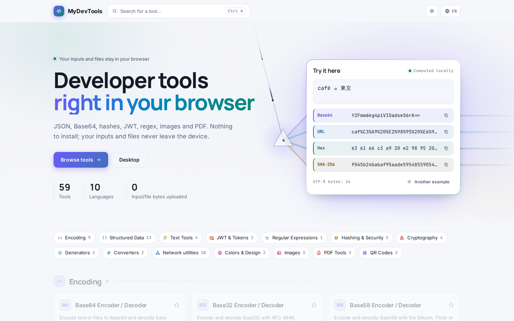
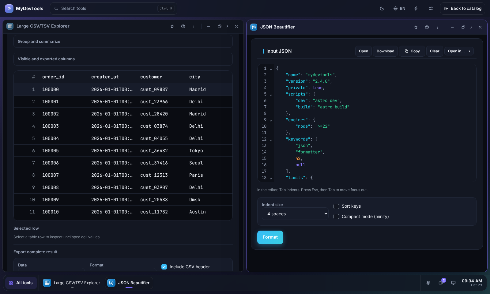
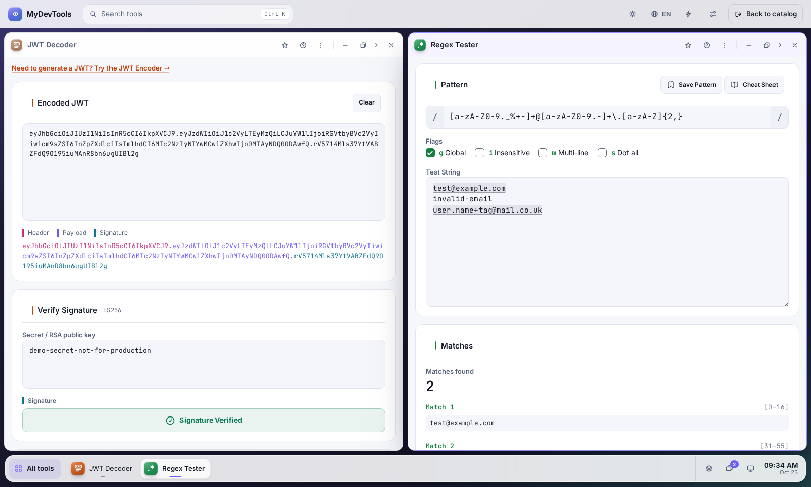

<div align="center">

<a href="https://mydevtools.app/"></a>

# MyDevTools

**62 free developer tools that run entirely in your browser.**
JSON, Base64, JWT, hashes, regex, crypto keys, images, PDF — and explorers for multi-gigabyte CSV, JSON, logs, Parquet and SQLite files.
Your input and files never leave your device.

### 👉 [mydevtools.app](https://mydevtools.app/)

[](https://mydevtools.app/)


[](LICENSE)

[English](https://mydevtools.app/en/) · [Русский](https://mydevtools.app/ru/) · [Español](https://mydevtools.app/es/) · [Deutsch](https://mydevtools.app/de/) · [Português](https://mydevtools.app/pt/) · [中文](https://mydevtools.app/zh/) · [Français](https://mydevtools.app/fr/) · [日本語](https://mydevtools.app/ja/) · [한국어](https://mydevtools.app/ko/) · [हिन्दी](https://mydevtools.app/hi/)

<a href="https://mydevtools.app/">
  <picture>
    <source media="(prefers-color-scheme: dark)" srcset="docs/assets/home-dark.png">
    
  </picture>
</a>

</div>

## Why MyDevTools

- **Private by design.** The site is a set of static pages. Every tool processes your input inside the browser — no uploads, no server-side processing, no account.
- **Built for big files.** Explorers stream files of many gigabytes in Web Workers with chunked reads, progress and cancel: filter a 20M-row Parquet file, diff two 500 MB files, browse a CSV that would freeze a spreadsheet.
- **Fast where it matters.** Hashing, encryption, compression, image, PDF, regex and QR processing run in WebAssembly compiled from Rust; DuckDB and SQLite run as official WASM builds.
- **Works offline.** Once a page has been opened, it keeps working without a connection. Install it as a PWA for quick access.
- **10 languages.** The interface and every tool guide are translated: English, Russian, Spanish, German, Portuguese, Chinese, French, Japanese, Korean and Hindi.
- **Free.** No ads, no paywall, no sign-up.

## Desktop mode

Working with several tools at once? Open **[Desktop](https://mydevtools.app/en/desktop/)** — a windowed workspace in the browser tab. Every tool runs in its own window: browse a large CSV next to a JSON formatter, or decode a JWT while testing a regex, without losing input when you switch.

- Open any tool from the launcher (`Ctrl+K`), desktop folders or the taskbar.
- Drag, resize, maximize and minimize windows; dock them side by side with `Alt+Shift+←/→`.
- Save named layouts and come back to the same arrangement; favorites and recent tools sit in a side column; pick your own wallpaper.
- Layouts store only window positions — never the text, files or results inside the tools.

<p align="center">
  <a href="https://mydevtools.app/en/desktop/"></a>
</p>
<p align="center">
  <a href="https://mydevtools.app/en/desktop/"></a>
</p>

## Tools

Every tool works on its own page in all 10 languages; the links below open the English version.

### Encoding

| Tool | What it does |
|---|---|
| [Base64 Encoder / Decoder](https://mydevtools.app/en/base64-encoder/) | Encode text or files to Base64 and decode back: standard or URL-safe alphabet, padding control, 76-char line wrap and image preview. |
| [Base32 Encoder / Decoder](https://mydevtools.app/en/base32-encoder/) | Encode and decode Base32 with RFC 4648, Crockford or z-base-32 alphabets, padding and letter-case options, for text and files. |
| [Base58 Encoder / Decoder](https://mydevtools.app/en/base58-encoder/) | Encode and decode Base58 with the Bitcoin, Flickr or Ripple alphabet for text and files up to 1 MiB. |
| [Hex Encoder / Decoder](https://mydevtools.app/en/hex-encoder/) | Convert text or files to hexadecimal and back. Pick charset and case; decode hex with spaces, colons, dashes or 0x prefixes. |
| [Hex Viewer](https://mydevtools.app/en/hex-viewer/) | Open a local file as hex and ASCII/UTF-8, jump to an offset, search for bytes, and chart block entropy. |
| [Archive Explorer](https://mydevtools.app/en/archive-explorer/) | Open ZIP, TAR, TAR.GZ and Zstandard or Brotli archives, list their contents, safely extract selected files and create new ZIP or TAR archives. |
| [Compression Benchmark](https://mydevtools.app/en/compression-benchmark/) | Compress your own file with gzip, Brotli and Zstandard at the levels you choose and compare size, ratio, speed and memory. |
| [URL Encoder / Decoder](https://mydevtools.app/en/url-encoder/) | Percent-encode and decode URLs and query strings in component, URI or form mode, with UTF-8, UTF-16 or Latin-1 charsets. |
| [HTML Entity Encoder / Decoder](https://mydevtools.app/en/html-entity-encoder/) | Escape HTML special characters as named, decimal or hex entities and decode entities back to text. Handles emoji correctly. |

### Structured data

| Tool | What it does |
|---|---|
| [JSON Beautifier](https://mydevtools.app/en/json-beautifier/) | Format, minify and validate JSON: 2/4-space or tab indent, recursive key sorting, exact big numbers, open and save .json files. |
| [JSON to TypeScript Converter](https://mydevtools.app/en/json-to-typescript/) | Generate TypeScript interfaces or type aliases from a JSON sample: nested types, merged array items, optional fields, export keyword. |
| [Large JSON / JSONL Explorer](https://mydevtools.app/en/json-explorer/) | Open, index, search and export large JSON and JSONL files locally with a virtual table, lazy tree and exact numeric values. |
| [Large CSV/TSV Explorer](https://mydevtools.app/en/csv-explorer/) | Open, filter, sort, group, inspect and export very large CSV or TSV files locally — with column types and CSV, JSONL or Parquet export. |
| [Large Log Analyzer](https://mydevtools.app/en/log-analyzer/) | Stream, filter, chart and export very large Serilog, .NET, Nginx, JSON Lines and text logs locally. |
| [Parquet Explorer](https://mydevtools.app/en/parquet-explorer/) | Open a local Parquet file, inspect its schema and row groups, filter rows, group and summarize, and browse selected columns in a virtualized table. |
| [Local Data Playground](https://mydevtools.app/en/local-data-playground/) | Import local CSV, JSON, JSONL or Parquet files and query them with DuckDB SQL. |
| [SQLite Explorer](https://mydevtools.app/en/sqlite-explorer/) | Open a local SQLite database: browse tables, views and indexes, run SQL and export results. |
| [Data Format Converter](https://mydevtools.app/en/data-format-converter/) | Convert local CSV, JSON, JSONL and Parquet files, choose column types and preview the result. |
| [XML Beautifier](https://mydevtools.app/en/xml-beautifier/) | Pretty-print or minify XML with 2/4-space or tab indent; keeps comments, CDATA and processing instructions and reports parse errors. |
| [YAML Beautifier/Validator](https://mydevtools.app/en/yaml-beautifier-validator/) | Validate YAML and reformat it into clean block style with 2-space indentation; errors show line and column. |
| [Cron Expression Generator](https://mydevtools.app/en/cron-generator/) | Build a cron expression field by field — minute, hour, day, month, weekday — with validation, a plain-language description and the next 5 run times. |
| [Cron Expression Parser](https://mydevtools.app/en/cron-parser/) | Explain a cron expression in plain language, validate every field and list the next 5 run times in your local time zone. Presets and @macros included. |

### Text

| Tool | What it does |
|---|---|
| [Word / Character Counter](https://mydevtools.app/en/word-counter/) | Count words, characters, lines, paragraphs and sentences as you type, with reading and speaking time. Emoji and Chinese/Japanese text are counted correctly. |
| [Text Case Converter](https://mydevtools.app/en/text-case-converter/) | Convert text to camelCase, snake_case, kebab-case, Title Case, Sentence case, UPPER or lower case. Splits identifiers like XMLHttpRequest correctly. |
| [Text Diff Viewer](https://mydevtools.app/en/text-diff-viewer/) | Compare two texts or files line by line: added, removed and changed lines shown side by side or as a unified diff, with word-level highlights. |
| [Large File Diff](https://mydevtools.app/en/large-file-diff/) | Compare two large local files line by line or byte by byte, with whitespace, line-ending and encoding options and a downloadable report. |

### JWT & tokens

| Tool | What it does |
|---|---|
| [JWT Decoder](https://mydevtools.app/en/jwt-decoder/) | Decode a JWT header and payload, check exp/nbf/iat dates and verify HS256/384/512 or RS256/384/512 signatures. |
| [JWT Encoder](https://mydevtools.app/en/jwt-encoder/) | Create and sign JWTs with HS256, HS384 or HS512. Edit header and payload JSON; claim order and extra header fields like kid are kept. |

### Regular expressions

| Tool | What it does |
|---|---|
| [Regex Tester](https://mydevtools.app/en/regex-tester/) | Test regular expressions live with the Rust regex engine (WebAssembly): match highlighting, capture and named groups, i/m/s flags and saved patterns. |

### Hashing & security

| Tool | What it does |
|---|---|
| [Hash Calculator](https://mydevtools.app/en/hash-calculator/) | Hash text or multiple files sequentially with 39 algorithms. Compare expected digests, track speed and ETA, and export results as TXT, CSV or JSON. |
| [Password Generator](https://mydevtools.app/en/password-generator/) | Generate random passwords of 4–128 characters from uppercase, lowercase, digits and your own symbol set, using the browser's secure RNG. |

### Cryptography

| Tool | What it does |
|---|---|
| [HMAC Calculator](https://mydevtools.app/en/hmac-calculator/) | Compute HMAC-SHA256 or HMAC-SHA512 of a message with a secret key, live as you type. Hex output, UTF-8 input, empty messages supported. |
| [AEAD File Encrypt/Decrypt](https://mydevtools.app/en/aead-file/) | Encrypt a file with a password using AES-256-GCM or (X)ChaCha20-Poly1305 and Argon2id, then decrypt it again. |
| [OpenSSH Keys](https://mydevtools.app/en/openssh-keys/) | Generate Ed25519, ECDSA or RSA SSH key pairs, optionally passphrase-protected, and convert between OpenSSH, PKCS#8 and SPKI PEM. |
| [File Signature](https://mydevtools.app/en/file-signature/) | Verify and create file signatures: OpenSSH `ssh-keygen -Y` (with allowed_signers), minisign and raw OpenSSL signatures with Ed25519, ECDSA P-256/P-384 or RSA keys in PEM, OpenSSH or JWK. |
| [X.509 Certificates](https://mydevtools.app/en/x509/) | Create self-signed X.509 certificates and CSRs with Ed25519 or ECDSA keys, and decode certificates or CSRs from PEM/DER. |

### Generators

| Tool | What it does |
|---|---|
| [UUID/GUID Generator](https://mydevtools.app/en/uuid-generator/) | Generate random UUID v4 or time-ordered UUID v7 in batches of up to 100, as hyphenated, plain, braced or URN strings, with copy and TXT download. |
| [Lorem Ipsum Generator](https://mydevtools.app/en/lorem-ipsum-generator/) | Generate Lorem Ipsum placeholder text by paragraphs, sentences or words (1–1000) as plain text, HTML with `<p>` tags or Markdown, with word counts. |

### Converters

| Tool | What it does |
|---|---|
| [Unit Converter](https://mydevtools.app/en/unit-converter/) | Convert length, weight, temperature and volume between metric, imperial and US units as you type, with the formula and quick reference conversions. |
| [Date Converter](https://mydevtools.app/en/date-converter/) | Convert Unix timestamps in seconds or milliseconds to ISO 8601, RFC 5322, UTC, local or custom-formatted dates and back, live. |

### Network

All but the subnet calculator run through the optional [local Windows agent](apps/local-agent/README.md): requests and probes leave your own computer, not a MyDevTools server.

| Tool | What it does |
|---|---|
| [IP Subnet Calculator](https://mydevtools.app/en/ip-subnet-calculator/) | IPv4 and IPv6 subnet calculator: network, broadcast, netmask, host range, address count and address type from CIDR or IP + mask input. |
| [HTTP Client](https://mydevtools.app/en/http-client/) | Send HTTP requests from your Windows machine through a local companion, with no account or MyDevTools proxy. |
| [Path Trace](https://mydevtools.app/en/path-trace/) | Watch packet loss and latency at each hop. ICMP probes leave your computer through the local agent. |
| [DNS Lookup](https://mydevtools.app/en/dns-lookup/) | Look up A, AAAA, CNAME, MX, NS, TXT, SOA and PTR records through the DNS resolver on your computer. |
| [TCP Connect](https://mydevtools.app/en/tcp-connect/) | Open one TCP connection to a host and port you choose, and see how long the handshake takes. |
| [TLS Certificate](https://mydevtools.app/en/tls-inspect/) | Open one TLS handshake to a host and port you choose, and see the protocol, the cipher, the expiry and the chain. |
| [WHOIS Lookup](https://mydevtools.app/en/whois-lookup/) | Ask one WHOIS server for one name and read the reply from TCP port 43. |
| [ASN Lookup](https://mydevtools.app/en/asn-lookup/) | Find the network that announces one address, using a prefix table stored on this computer. |
| [Port Scanner](https://mydevtools.app/en/port-scanner/) | Scan the TCP ports of one host from your computer: a common list, 1–1024, all 65535 or your own ranges. |
| [Network Scanner](https://mydevtools.app/en/network-scanner/) | Find the devices on your local network: ping, a few TCP ports and the ARP table, from your own computer. |

### Colors & design

| Tool | What it does |
|---|---|
| [Color Converter](https://mydevtools.app/en/color-converter/) | Convert colors between HEX, RGB, HSL and CMYK, get a 9-step shades palette and check WCAG contrast between two colors. |
| [Markdown Preview](https://mydevtools.app/en/markdown-preview/) | Write Markdown with a live HTML preview side by side: GitHub Flavored tables, task lists, strikethrough. Copy sanitized HTML or download an .html file. |

### Images

| Tool | What it does |
|---|---|
| [Image Compressor](https://mydevtools.app/en/image-compressor/) | Compress a JPEG, PNG or WebP image: set quality 1–100, keep or change the format and compare sizes. |
| [Image Converter](https://mydevtools.app/en/image-converter/) | Convert images between PNG, JPEG, WebP, GIF, BMP, ICO, TIFF and TGA. |
| [Image Resizer](https://mydevtools.app/en/image-resizer/) | Resize an image to exact pixel dimensions with aspect-ratio lock and Lanczos3 resampling, then save as JPEG, PNG or WebP. |
| [Batch Image Processor](https://mydevtools.app/en/image-batch/) | Resize, convert and compress many images at once on parallel workers: fit into a max width/height, JPEG/PNG/WebP with quality, ZIP of results and a size/speed report (CSV). |

### PDF

| Tool | What it does |
|---|---|
| [PDF Compressor](https://mydevtools.app/en/pdf-compressor/) | Shrink PDF files losslessly: recompress streams, merge duplicate objects and strip metadata. Batch processing. |
| [PDF Merger](https://mydevtools.app/en/pdf-merger/) | Merge two or more PDF files into one merged.pdf, in the order you set with move up/down. Pages keep size and rotation. |
| [PDF Page Organizer](https://mydevtools.app/en/pdf-organizer/) | Rotate, delete, reorder and split PDF pages with thumbnails; split every N pages or by ranges, download parts as ZIP. |
| [PDF to Text](https://mydevtools.app/en/pdf-to-text/) | Extract the text layer of PDF files into UTF-8 .txt files, with Unicode font mapping and batch processing (no OCR). |

### QR codes

| Tool | What it does |
|---|---|
| [QR Code Generator](https://mydevtools.app/en/qr-code-generator/) | Create a QR code from a URL or text with colors, square/dots/rounded styles, error correction L–H, a center logo, and PNG or SVG download. |
| [QR Code Scanner](https://mydevtools.app/en/qr-scanner/) | Read a QR code with your camera or from a PNG, JPEG or WebP image, then copy the text or open the link. |

## Privacy

- Tool input, files, keys and passwords are processed in the browser and are never sent anywhere.
- Only explicit settings (theme, language, favorites, recent tools, per-tool options) are stored, in your browser's `localStorage`. Tool input is not persisted.
- The site counts anonymous tool usage (tool ID, event type, a coarse duration bucket, an error category) to decide what to improve. It never sends your input, files or any visitor identifier. Details: [`docs/analytics.md`](docs/analytics.md).
- Network tools are the one exception to "browser only": they need the optional [local Windows agent](apps/local-agent/README.md), and their traffic goes from your computer straight to the target — never through a MyDevTools server.

## Tech stack

| Layer | What is used |
|---|---|
| Site | [Astro](https://astro.build/) static build, vanilla TypeScript controllers, no UI framework |
| Compute | Rust → WebAssembly (`wasm-bindgen`), 12 crates in [`wasm/`](wasm) |
| Data | DuckDB-WASM, `@sqlite.org/sqlite-wasm`, hyparquet |
| Editors | CodeMirror 6, lazy-loaded on editor pages |
| Large files | Web Workers, 1 MiB chunks, progress and `AbortController` cancel |
| Hosting | GitHub Pages behind Cloudflare, PWA service worker |
| Tests | `node:test` unit tests, Playwright visual and cross-browser suites, `cargo test` |

## Development

Requirements: Node 25, npm 11, Rust 1.88 with the `wasm32-unknown-unknown` target, `wasm-bindgen-cli` 0.2.108 and PowerShell 7 (`pwsh`). The `cryptography` crate also needs `clang` and `llvm-ar`.

```bash
npm install
npm run build:wasm                     # Rust → apps/site/src/generated/wasm (required before the first build)
npm run dev -w @mydevtools/site        # http://localhost:3312/
npm run verify -w @mydevtools/site     # astro check + i18n + unit tests + build + dist smoke
cargo test --workspace --manifest-path wasm/Cargo.toml
```

Repository layout:

```
apps/site/          live Astro site: routes, tool shells and controllers, i18n, workers
  src/registry/     tools, categories and locales — the single source of truth
wasm/<domain>/      Rust crates compiled to WebAssembly
apps/local-agent/   optional Windows companion for the HTTP client and network tools
e2e/                Playwright visual-regression and cross-browser suites
docs/               inventory, design system, QA notes
```

Contributor and architecture guide: [`AGENTS.md`](AGENTS.md). Release procedure: [`apps/site/RELEASING.md`](apps/site/RELEASING.md).

## Feedback

Found a bug or missing a tool? [Open an issue](https://github.com/ILexV/mydevtools/issues). Every tool page also has a short "What should we improve next?" vote.

If MyDevTools saves you time, a ⭐ on GitHub helps other developers find it.

## License

[MIT](LICENSE) © ILexV. Third-party libraries keep their own licenses.
